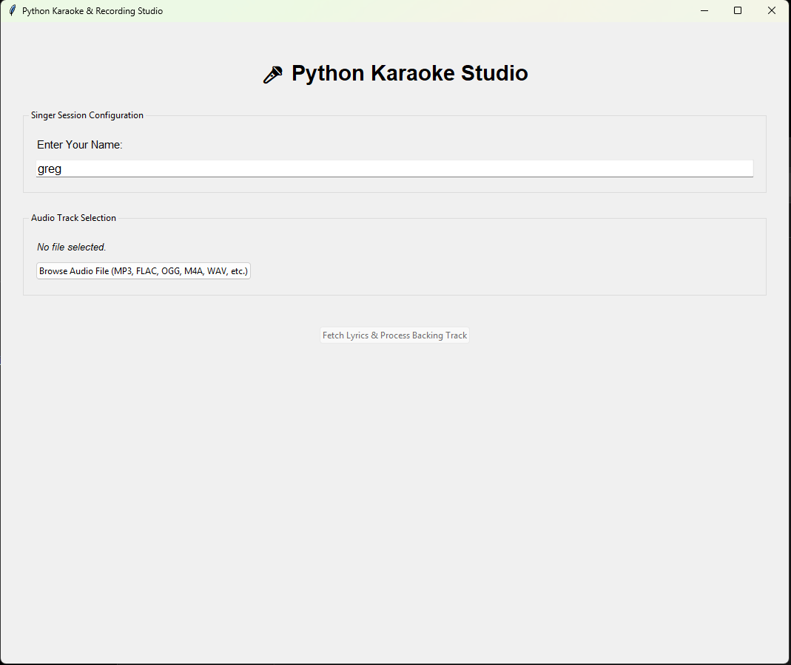
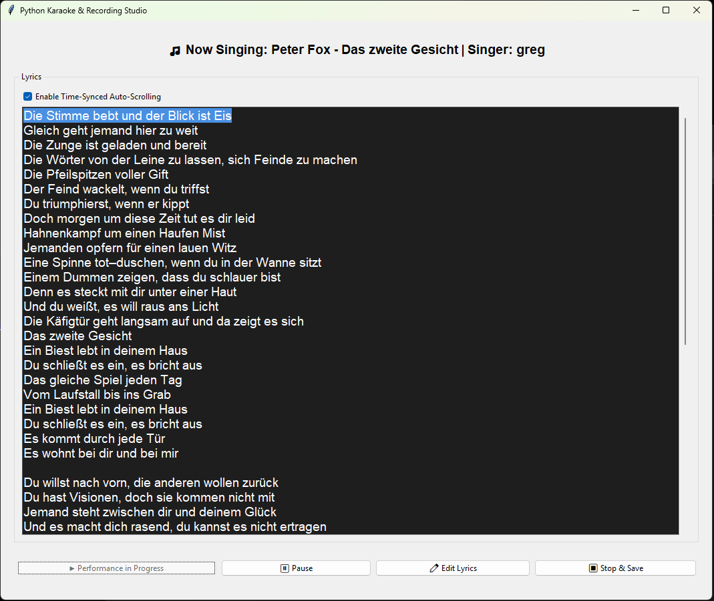
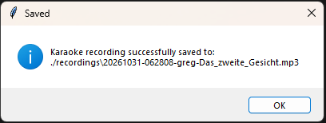

# Simple Karaoke App for your Offline Files

mostly Gemini Generated

sadly only runs on Windows - couldn't get the OpenVINO Plugin for Audacity to work on Linux - this is the only incompatability AFAIK

## Features

- Takes in any audio format that audacity supports
- searches lrclib.net for song with audio file tags (artist - title only)
- supports providing your own lyrics
- extracts the vocals using Audacity with OpenVINO Plugin
- lowers vocals by 10db and mixes back together
- supports both time synced und unsynced lyrics
- records your main microphone during playback so you can use your recording later
- fully offline processing - just the lrclib API is used

## Screenshots

## Installation:

### Setting up Audacity

This step is vitally important since the vocal extraction happens here.

Make sure Audacity 3.7+ is installed with the OpenVINO Music Separation Plugin enabled.

Also import the Makro "MusicSeparation" (Name MUST match in Capitalization) from MusicSeparation.txt into Audacity - this Makro will be used for lowering the vocal volume by 10db.

Also make sure Edit > Preferences > Modules > mod-script-pipe is set to Enabled, and Audacity is restarted and running with a blank project.

### Setting up Python

#### Recommended: Create venv and Activate

python -m venv .venv

.venv\Scripts\Activate.ps1

#### Install requirements

pip install mutagen requests sounddevice numpy pygame soundfile

## Running the Game:

If not already - open the venv

.venv\Scripts\Activate.ps1

then just:

python .\karaoke_app.py

Make sure Audacity 3.7 with the required Plugins and Makro is open and running with a new project (no other files already opened in audacity)
